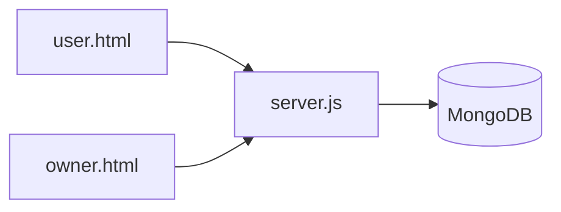

# Live Delivery Tracker

## Overview

Live Delivery Tracker is a Node.js prototype with separate owner and user pages for viewing delivery locations. The server is responsible for connecting the browser views to the configured MongoDB-backed data flow.

## Architecture



## Project structure

- `server.js` — Express/server entry point and data integration.
- `index.html` — landing page.
- `owner.html` — owner/operator view.
- `user.html` — delivery user view.

## Setup

```bash
npm install
npm start
```

Configure the database connection through an environment variable. Do not commit credentials or real location data.

## Security considerations

Live location data is sensitive. A production version needs authenticated roles, authorization checks, transport encryption, retention controls, and audit logging.

## Status

Prototype project.

## License

No license is currently declared.
