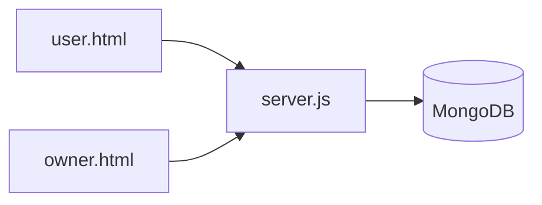

# Live Delivery Tracker

## Overview

Live Delivery Tracker is a Node.js prototype with separate owner and user pages for viewing delivery locations. The server is responsible for connecting the browser views to the configured MongoDB-backed data flow.

## Architecture



## Project structure

- `server.js` — Express/server entry point and data integration.
- `index.html` — landing page.
- `owner.html` — owner/operator view.
- `user.html` — delivery user view.

## Setup

```bash
npm install
npm start
```

Configure the database connection through an environment variable. Do not commit credentials or real location data.

## Security considerations

Live location data is sensitive. A production version needs authenticated roles, authorization checks, transport encryption, retention controls, and audit logging.

## Status

Prototype project.

## License

No license is currently declared.

## Configuration

Copy `.env.example` to `.env` for local setup. Keep database, storage, mapping, notification, and authentication values out of Git.

## API and project docs

- [API reference](docs/API.md)
- [Contributing](CONTRIBUTING.md)
- [Security policy](SECURITY.md)
- [Changelog](CHANGELOG.md)

## Accessibility and mobile notes

The repository contains browser-facing pages intended to be tested at narrow and wide viewport sizes. Before deployment, verify keyboard navigation, visible focus states, form labels, meaningful image alternatives, readable contrast, touch-sized controls, and layouts without horizontal scrolling.

## Validation

No automated test suite is declared unless noted in `package.json`. At minimum, install dependencies, run the documented start/build/type-check commands, and manually exercise the primary page and API health route where available.
